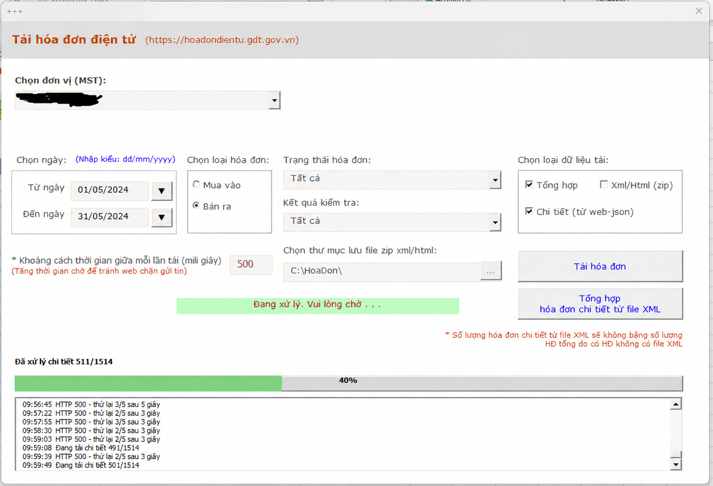

# Tải Hóa Đơn Điện Tử

File Excel VBA giúp tải, tra cứu và tổng hợp hóa đơn từ `hoadondientu.gdt.gov.vn`.

**Phiên bản đã phát hành mới nhất: v6.7.8**

[Tải TaiHoaDonDienTu_v6.7.8.xlsm](https://github.com/dieutx/TaiHoaDonDienTu/releases/latest/download/TaiHoaDonDienTu_v6.7.8.xlsm)

> 💡 **Không có Excel hoặc muốn chạy tự động theo lịch?** Dùng bản PowerShell
> [hddt-downloader-windows](https://github.com/dieutx/hddt-downloader-windows) —
> cùng logic tải hóa đơn (endpoint `query`/`sco-query`, phân trang theo `state`,
> retry khi bị giới hạn tốc độ, chuỗi hóa đơn liên quan) nhưng không cần Microsoft
> Excel, tự nhận dạng CAPTCHA và chạy được trên Command Prompt. Hai công cụ giải
> quyết chung một bài toán; nếu cần thêm **tờ khai thuế GTGT** từ Cổng Dịch vụ
> công thì xem thêm [tai-ho-so-thue-gtgt](https://github.com/dieutx/tai-ho-so-thue-gtgt).



## Cài đặt

1. Tải file `.xlsm` từ liên kết phía trên.
2. Mở **Properties** của file và chọn **Unblock** nếu Windows hiển thị tùy chọn này.
3. Mở file bằng Microsoft Excel và cho phép chạy macro.
4. Đăng nhập bằng tài khoản trên hệ thống hóa đơn điện tử.

## Cách sử dụng

1. Chọn đơn vị và loại hóa đơn **Mua vào** hoặc **Bán ra**.
   **Nguồn hóa đơn**: **Tất cả** (mặc định), **Hóa đơn thông thường**, hoặc **Hóa đơn từ máy tính tiền**, áp dụng cho cả hai chiều mua/bán.
2. Chọn ngày bằng lịch hoặc nhập theo định dạng `dd/mm/yyyy`.
3. Chọn dữ liệu cần tải: tổng hợp, chi tiết hoặc XML/HTML.
4. Chọn trạng thái hóa đơn và kết quả kiểm tra nếu cần lọc.
5. Bấm **Tải hóa đơn** và theo dõi kỳ, nguồn API, trang, HTTP, số hóa đơn cùng thời gian phản hồi trong log. Nhãn **Thời gian xử lý** chạy liên tục và đặt lại từ `00:00:00` mỗi phiên; log ghi dòng **Tổng số hóa đơn cần xử lý** và mỗi dòng chi tiết có dạng `n/N`.
6. Có thể bấm **Tạm dừng/Tiếp tục** hoặc **Dừng**; dữ liệu đã tải trước khi dừng vẫn được giữ lại.
7. Xem kết quả tại các sheet tổng hợp, chi tiết và `BaoCao_LoiTaiHD`.

Bản cập nhật source 28/10/2026 chia kỳ **hóa đơn máy tính tiền** tối đa **10 ngày** và tự chia nhỏ lại khi API báo giới hạn khác (ví dụ 5 ngày). Tra cứu nguồn này gửi thêm CAPTCHA theo giao thức đã kiểm chứng từ HAR và test live; không lưu CAPTCHA trong URL báo lỗi hoặc hàng đợi retry.

Chọn thêm **PDF** để dựng PDF vào cùng thư mục lưu. Ưu tiên XML gốc; nếu không có XML, dùng chi tiết API và tổng hợp đúng cùng hóa đơn để dựng PDF khi đủ dữ liệu. PDF ghi rõ nguồn API trong trường hợp này. Có thể chọn PDF riêng; XML/ZIP tải được vẫn giữ để đối chiếu. Nút **XML -> PDF** chuyển các XML có sẵn trong một thư mục, không cần đăng nhập. Máy cần **Microsoft Edge hoặc Google Chrome**; mẫu hóa đơn đã nhúng trong workbook, không cần chép HTML/CSS đi kèm. Chi tiết: [chia kỳ ngày và PDF](docs/DATE_LIMIT_AND_XML_PDF_2026-10-28.md).

Từ v6.7.7, chọn **No** tại câu hỏi xóa dữ liệu để tải bổ sung chống trùng và bỏ phần chi tiết/XML đã xác minh hoàn tất. Lưu workbook để dùng trạng thái sau khi đóng Excel. Xem [hướng dẫn và giới hạn resume](docs/CORE_FIXES_2026-10-13.md).

Khi chọn riêng một nguồn và chọn **Yes**, chỉ xóa các dòng đã xác định thuộc đúng đơn vị, chiều mua/bán và nguồn đang chọn; giữ nguồn khác và các dòng cũ chưa xác định nguồn. **Tất cả + Yes** giữ cách xóa dữ liệu của chiều đang chọn như trước. Các bản sửa mới và kiểm thử: [sửa lỗi và bộ lọc nguồn 14/10/2026](docs/FIXES_AND_SOURCE_FILTER_2026-10-14.md).

## Tính năng chính

- Tải hóa đơn mua vào và bán ra.
- Hỗ trợ hóa đơn thông thường và hóa đơn từ máy tính tiền.
- Chọn ngày bằng date picker hoặc nhập trực tiếp.
- Hiển thị tiến độ và log chi tiết từng kỳ/trang `query` và `sco-query`.
- Tạm dừng, tiếp tục hoặc dừng an toàn sau request hiện tại.
- Đồng hồ **Thời gian xử lý** chạy liên tục suốt phiên tải, reset theo từng lần bắt đầu; số liệu tiến độ và ETA hiển thị theo giai đoạn đang xử lý.
- Retry khi gặp lỗi tạm thời hoặc HTTP 429/500.
- Tải dữ liệu tổng hợp, chi tiết và ZIP XML/HTML.
- Tải XML bằng tối đa 6 kết nối HTTP bất đồng bộ, giãn cách khởi đầu 300 ms, cooldown chung khi gặp 429 và phục hồi dần. Xem [logic tải song song](docs/XML_PARALLEL_DOWNLOAD.md).
- Tải chi tiết và thông tin liên quan bằng tối đa 4 kết nối HTTP bất đồng bộ; khoảng nghỉ trên form điều tiết các lần gửi, tự giảm tải khi gặp 429/503/504. Kết quả được ghi vào Excel tuần tự. Xem [logic tải JSON song song](docs/JSON_PARALLEL_DOWNLOAD.md).
- Hiển thị mẫu số hóa đơn trên sheet chi tiết và giữ MST người mua/người bán dưới dạng Text để không mất số `0` ở đầu.
- Lưu ngày hóa đơn dưới dạng ngày thật của Excel và luôn hiển thị `dd/mm/yyyy`, không phụ thuộc thiết lập vùng của Windows. Bản sửa 6.7.6 chuyển thời điểm có múi giờ về UTC+7 trước khi lấy ngày; ngày không có múi giờ giữ nguyên. Xem [review và kiểm thử 6.7.6](docs/REVIEW_2026-10-08.md).
- Điền dữ liệu dùng chung cho các dòng chi tiết mà không chiếm hoặc xóa clipboard của Windows.
- Lấy chuỗi hóa đơn thay thế/điều chỉnh và thông tin sai sót liên quan; nếu hết lượt retry, lỗi được hiển thị ngay tại cột kết quả tương ứng.
- Báo cáo lỗi chỉ giữ những tác vụ chưa xử lý thành công.
- Các sheet tắt **Wrap Text** và căn giữa theo chiều dọc; dữ liệu mới giữ cùng định dạng. Nội dung dài vẫn được lưu đầy đủ và có thể đọc trên thanh công thức.

## Yêu cầu

- Windows.
- Microsoft Excel có hỗ trợ VBA.
- Kết nối Internet và tài khoản hợp lệ tại `hoadondientu.gdt.gov.vn`.

## Lưu ý bảo mật

- Không chia sẻ file đã chứa token, cookie, mã số thuế gắn với tài khoản đăng nhập hoặc dữ liệu hóa đơn thật. File phát hành giữ MST định tuyến trong `LinkTraCuu` để tạo link tra cứu hóa đơn.
- Nếu gặp lỗi 401/403, hãy đăng nhập lại để tạo phiên mới.
- Không đặt khoảng nghỉ giữa các request quá thấp vì hệ thống có thể trả HTTP 429.
- Xem [hướng dẫn xử lý sự cố](docs/TROUBLESHOOTING.md) khi cần.

## Dành cho developer

Source VBA nằm trong `src`, template workbook nằm trong `template` và script build nằm trong `build`.

Hướng dẫn thêm thông báo cập nhật tùy chọn: [docs/UPDATE_CHECK.md](docs/UPDATE_CHECK.md).

Các sửa lỗi v6.7.7 cho XML namespace, kiểu dữ liệu XML, phản hồi đăng nhập và link BKAV: [docs/COMPATIBILITY_FIXES_2026-10-13.md](docs/COMPATIBILITY_FIXES_2026-10-13.md).

Bản sửa nút Đăng nhập thoát im lặng khi chưa có CAPTCHA, kèm kiểm thử luồng tài khoản đã lưu: [sửa luồng đăng nhập 18/10/2026](docs/LOGIN_FLOW_FIX_2026-10-18.md).

Bản sửa log, ghi dữ liệu, tải bổ sung/resume và Retry-After: [docs/CORE_FIXES_2026-10-13.md](docs/CORE_FIXES_2026-10-13.md).

Bản sửa đồng hồ **Thời gian xử lý**, log tổng số hóa đơn và căn thanh thời gian: [docs/PROGRESS_UI_2026-10-14.md](docs/PROGRESS_UI_2026-10-14.md).

Source hiện tại là **6.7.8**. Xem [ghi chú phát hành 6.7.8](docs/RELEASE_v6.7.8.md) và [kiểm thử ngày/PDF](docs/DATE_LIMIT_AND_XML_PDF_2026-10-28.md). Kiểm thử nền giao diện: [kiểm chứng giao diện 6.7.7](docs/UI_COMPLETION_2026-10-15.md).

Bản chỉnh tiếp theo hiển thị số hóa đơn/trang ngay khi đang lấy danh sách, mở rộng nhật ký và cho đọc dòng được chọn; xem [sửa tiến độ phân trang và nhật ký](docs/UI_PAGINATION_2026-10-15.md).

Phản hồi HTTP 200 kèm nội dung HTML (token bị chặn hoặc gateway trả trang web) không còn bị tính là tải thành công: request được thử lại, hết lượt thì vào retry cuối phiên và báo cáo lỗi ghi rõ nguyên nhân thay cho lỗi parse JSON; xem [xử lý phản hồi HTML](docs/HTML_200_RESPONSE_2026-10-15.md).

Trước khi phát hành, chạy bộ kiểm tra dưới đây. Mỗi bước chạy trong tiến trình riêng; nếu có bước lỗi, toàn bộ quy trình dừng và không chạy các bước tiếp theo.

```powershell
.\build\Test-Release.ps1 -Version '6.7.8' -OutputPath '.\dist\release-candidate\TaiHoaDonDienTu_v6.7.8.xlsm'
```

Kết quả review mở rộng và các lỗi tái hiện trước khi sửa: [review mở rộng 08/10/2026](docs/REVIEW_EXPANDED_2026-10-08.md). Các lệnh kiểm tra riêng lẻ:

```powershell
.\build\Build-Excel.ps1 -Version '6.7.8' -OutputPath '.\dist\TaiHoaDonDienTu_v6.7.8.xlsm'
.\tests\Test-RetryUiStatic.ps1
.\tests\Test-DetailInvoiceStatic.ps1
.\build\Test-Build.ps1 -BuiltWorkbook '.\dist\TaiHoaDonDienTu_v6.7.8.xlsm' -RunUserFormInstantiation
.\build\Test-PublicWorkbook.ps1 -WorkbookPath '.\dist\TaiHoaDonDienTu_v6.7.8.xlsm'
.\build\Test-DetailInvoiceRuntime.ps1 -BuiltWorkbook '.\dist\TaiHoaDonDienTu_v6.7.8.xlsm'
.\build\Test-RelatedInvoiceRuntime.ps1 -BuiltWorkbook '.\dist\TaiHoaDonDienTu_v6.7.8.xlsm'
.\build\Test-InvoiceDateRuntime.ps1 -BuiltWorkbook '.\dist\TaiHoaDonDienTu_v6.7.8.xlsm'
.\build\Test-ReviewFixesRuntime.ps1 -BuiltWorkbook '.\dist\TaiHoaDonDienTu_v6.7.8.xlsm'
.\build\Test-ExtendedReviewRuntime.ps1 -BuiltWorkbook '.\dist\TaiHoaDonDienTu_v6.7.8.xlsm'
.\build\Test-CompatibilityFixesRuntime.ps1 -BuiltWorkbook '.\dist\TaiHoaDonDienTu_v6.7.8.xlsm'
.\build\Test-LoginFlowRuntime.ps1 -BuiltWorkbook '.\dist\TaiHoaDonDienTu_v6.7.8.xlsm'
.\build\Test-ProgressClockRuntime.ps1 -BuiltWorkbook '.\dist\TaiHoaDonDienTu_v6.7.8.xlsm'
.\build\Test-ModernUiRuntime.ps1 -BuiltWorkbook '.\dist\TaiHoaDonDienTu_v6.7.8.xlsm'
.\build\Test-ParallelJsonRuntime.ps1 -BuiltWorkbook '.\dist\TaiHoaDonDienTu_v6.7.8.xlsm'
.\build\Test-DatePdfRuntime.ps1 -BuiltWorkbook '.\dist\TaiHoaDonDienTu_v6.7.8.xlsm'
.\build\Test-PdfFallbackRuntime.ps1 -BuiltWorkbook '.\dist\TaiHoaDonDienTu_v6.7.8.xlsm'
.\build\Test-DatePdfRegression.ps1 -BuiltWorkbook '.\dist\TaiHoaDonDienTu_v6.7.8.xlsm'
.\tests\Test-ReleaseGate.ps1
.\tests\Test-UpdateRuntime.ps1 -BuiltWorkbook '.\dist\TaiHoaDonDienTu_v6.7.8.xlsm'
```

Đọc [CONTRIBUTING.md](CONTRIBUTING.md) và [SECURITY.md](SECURITY.md) trước khi gửi thay đổi.

## Nguồn tham khảo

Dự án phát triển từ ý tưởng và công cụ Excel VBA do thành viên **ongke0711** chia sẻ tại diễn đàn Giải Pháp Excel:

[Tải hóa đơn điện tử – Giải Pháp Excel](https://www.giaiphapexcel.com/diendan/threads/t%E1%BA%A3i-h%C3%B3a-%C4%91%C6%A1n-%C4%91i%E1%BB%87n-t%E1%BB%AD-https-hoadondientu-gdt-gov-vn-excel-vba.171723/)

Đây là dự án cộng đồng, không phải sản phẩm chính thức của cơ quan thuế. Repository hiện chưa công bố giấy phép phần mềm; xem thêm [NOTICE.md](NOTICE.md).

Từ v6.7.7: phục hồi dữ liệu chi tiết qua API khi XML lỗi 500/504,
giữ giãn cách cấu hình sau 429. Xem [phạm vi và kiểm thử](docs/DOWNLOADER_PARITY_2026-10-14.md).
