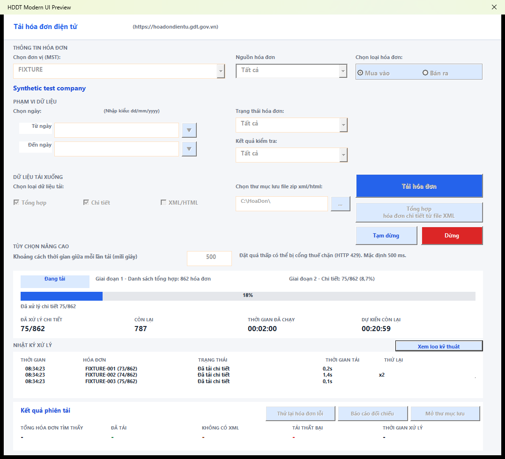

# Hoàn tất giao diện và build 6.7.7 — 15/10/2026

Tiếp tục working tree đang dở sau các bản sửa ngày 14/10. Source là **6.7.7**, chưa phát hành; bản công khai trong README và `update.json` vẫn là 6.7.6.

## Các điểm đã hoàn tất

- Loại bỏ handler trùng, thân hàm bị lặp ngoài procedure và các câu lệnh bị nối sai trong `frmTaiHoaDon`, giữ các bản sửa core và bộ lọc nguồn hiện có.
- Đổi kích thước form qua `Width`/`Height`, tính phần viền từ kích thước client. `InsideWidth` và `InsideHeight` là thuộc tính chỉ đọc, không thể gán trực tiếp ([Microsoft Forms reference](https://learn.microsoft.com/en-us/office/vba/language/reference/user-interface-help/insideheight-insidewidth-properties)).
- Khởi tạo runtime controls một lần; giữ đồng hồ hiển thị ngay từ trạng thái sẵn sàng. Giữ tên component, control, worksheet và cặp FRM/FRX.
- Đặt checkbox trong hệ tọa độ của `fraLoaiDuLieu`; giới hạn khối ghi chú XML trong cột trái. Đưa các lớp nền ra sau để không che thanh tiến độ.
- Ghi dữ liệu log vào từng cột `List(row, column)`; giữ tối đa 400 dòng. Cố định lại kích thước ListBox sau khi thêm log và khi form được kích hoạt, vì MSForms có thể trả control về kích thước mặc định khi tạo cửa sổ. Khung log cuối là 728 × 44 điểm.
- Khôi phục template build về `template/App_Template.xlsm`, bỏ phụ thuộc bản sao tạm trong `dist`. Tên artifact mặc định là `TaiHoaDonDienTu_vX.X.X.xlsm`.
- Khôi phục các lời gọi VBA thật trong regression detail; bỏ lời gọi helper PowerShell không tồn tại. Đồng bộ `VERSION` với `modVersion` ở 6.7.7.
- Regression core chọn thư mục XML thay riêng lời gọi hộp thoại hướng dẫn bằng `Debug.Print` trong bản VBA inject ở bộ nhớ. Các cập nhật control và kiểm tra thư mục thật vẫn chạy; ứng dụng giữ nguyên hộp thoại cho người dùng.

## Regression giao diện

`build/Test-ModernUiRuntime.ps1` kiểm tra bằng Excel COM:

- Khởi tạo lặp không thêm control; đồng hồ và checkbox nằm trong vùng hiển thị.
- Phần trăm `75/862 = 8,7%`, giới hạn 100%, ETA chỉ hiện khi đủ dữ liệu.
- Giá trị riêng của cả 5 cột log, giữ 400 dòng và kích thước sau khi form thực sự hiện lên.
- Chuyển log kỹ thuật/bảng log, pause/resume/stop.
- Số liệu đang chạy, tổng kết và reset giữa các phiên; giữ thời gian cuối phiên và bỏ ETA sau khi kết thúc.

Script inject fixture trong bộ nhớ, đóng workbook không lưu và xác nhận SHA256 không đổi. Tham số `-PreviewPath` và `-PreviewState idle|running|finished` tạo ảnh từ form thật với công ty/hóa đơn giả lập.

## Kiểm chứng cuối

Log, ảnh render và workbook kiểm thử nằm trong `dist/continue-20261014/`.

- Release gate đủ **18 bước**: `RELEASE CHECKS PASSED`, exit 0. Log: `dist/continue-20261014/release-gate-final.log`.

- Kiểm tra cấu trúc: 21 mục đạt; cả 6 UserForm khởi tạo thành công; source VBA trong workbook khớp source build.
- Regression ngày: 35 ca ISO và ca ngày thông báo related đạt.
- Regression core/resume, compatibility, fallback XML/detail và bộ lọc nguồn mua/bán đạt.
- Final retry với `Retry-After: 5` và cooldown fixture 1 giây: khoảng cách giữa hai request **5,057 giây**.
- Đồng hồ tăng từ `00:00:00` đến `00:00:03` trong vòng chờ; hash workbook không đổi.
- UI runtime mới đạt, gồm log 728 × 44 điểm sau khi hiện form, giá trị từng cột, giới hạn 400 dòng, pause/resume/stop và reset số liệu.
- JSON song song đạt cả các ca normal/default/buffer/related, retry, JSON hỏng, pause/stop/auth. Update đạt ca phiên bản mới, cùng phiên bản, JSON lỗi và offline.
- Ảnh trạng thái đang chạy và kết thúc được kiểm tra trực quan; phần render làm mới cửa sổ con trước `PrintWindow` để tránh lấy ảnh cache còn trống sau khi đổi trạng thái enabled.

### Workbook dùng thử

- File: `dist/continue-20261014/TaiHoaDonDienTu_v6.7.7.xlsm`.
- Kích thước: **413.047 byte**.
- SHA256: `23E43D934E03ECAEA23D37E4300D28630EA92A4FCD2AA082824991A90F661604`.
- Hash không đổi sau các lần runtime/render; không ghi đè các workbook hoặc report có sẵn. Chưa commit, push hoặc phát hành.

Môi trường kiểm chứng là Windows PowerShell 5.1, Excel COM 16.0 64-bit. Chưa kiểm chứng Office 32-bit hoặc GDT thật. Các bài HTTP dùng localhost; không sử dụng tài khoản hoặc hóa đơn thật.

Các bản sửa core kế thừa được mô tả tại [sửa lỗi và bộ lọc nguồn](FIXES_AND_SOURCE_FILTER_2026-10-14.md), [đồng hồ xử lý](PROGRESS_UI_2026-10-14.md) và [fallback XML/detail](DOWNLOADER_PARITY_2026-10-14.md).
