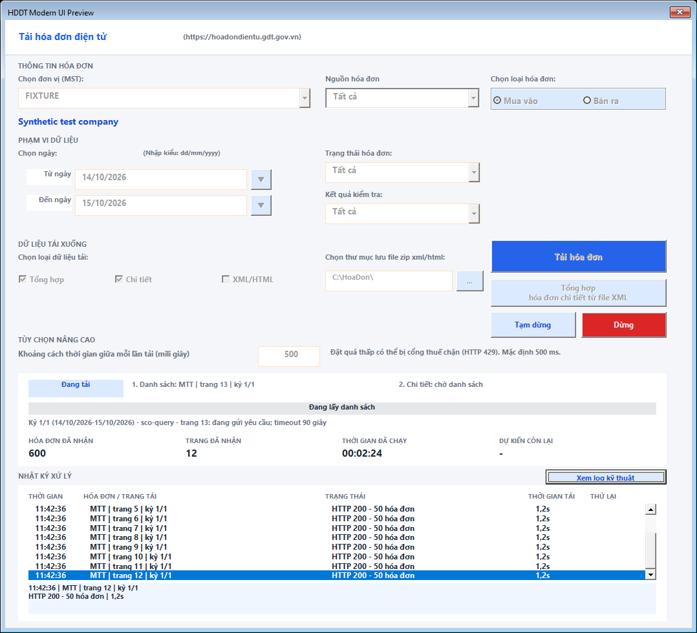

# Tiến độ phân trang và nhật ký — 15/10/2026

Ảnh dùng thực tế cho thấy đang lấy trang 12 nhưng dashboard vẫn ghi “chưa chạy”, `0/0`, còn lại 0 và 9%. Nguyên nhân: tổng hóa đơn chỉ được gán sau khi lấy hết danh sách; vùng log chỉ cao 44 điểm và cột hóa đơn chứa cả kỳ/ngày/nguồn/trang nên bị cắt.

## Thay đổi

- Khi đang lấy danh sách, hiển thị nguồn/trang hiện tại, số hóa đơn đã nhận và số trang đã nhận qua các nguồn/kỳ. Chưa có tổng thì thanh tiến độ ghi **Đang lấy danh sách**, không hiện phần trăm suy đoán. Pha chi tiết ghi **Chờ danh sách**.
- Khi lấy danh sách xong, chuyển về số chi tiết `n/N`, số còn lại và phần trăm như trước. Không chọn chi tiết thì ghi rõ **Không chọn**. ETA dùng thời gian pha chi tiết; thời gian lấy danh sách và related không làm tăng ước tính detail.
- Nhật ký đang tải cao 88 điểm, font 9; bảng kết quả chỉ xuất hiện khi phiên đã kết thúc. Có nút mở rộng nhật ký/hiện lại kết quả sau khi hoàn tất.
- Bật `IntegralHeight` để các hàng log hiện trọn vẹn thay vì cắt nửa dòng cuối, theo [Microsoft Forms reference](https://learn.microsoft.com/en-us/office/vba/language/reference/user-interface-help/integralheight-property).
- Năm cột dùng chung tọa độ với header; ưu tiên độ rộng cho hóa đơn/trang và trạng thái. Dòng phân trang rút gọn dạng `MTT | trang 12 | kỳ 1/1`; log kỹ thuật vẫn giữ kỳ ngày đầy đủ.
- Chọn một dòng để xem nội dung trong vùng riêng và tooltip. Khi đang đọc dòng cũ, dòng mới đến không kéo lựa chọn về cuối. Theo dõi tự động khi chọn dòng mới nhất; giữ tối đa 400 dòng.
- Nếu dừng giữa lúc phân trang, kết quả vẫn giữ số hóa đơn đã nhận và ghi danh sách chưa hoàn tất.

Không đổi endpoint, authentication, retry, phân trang hoặc dữ liệu hóa đơn; không sửa template/FRX hay đổi tên control/component cũ. Các thay đổi số liệu chỉ phục vụ hiển thị.

## Kiểm thử

`build/Test-ModernUiRuntime.ps1` bổ sung cảnh 12 trang MTT × 50 hóa đơn và một trang thường 20 hóa đơn: dashboard đạt 620 hóa đơn/13 trang, vẫn chờ danh sách, không hiện phần trăm/ETA trước khi có tổng. Kiểm tra chuyển sang detail, ETA, giữ dòng log được chọn khi cắt bớt dòng cũ, ẩn/hiện kết quả và kích thước log sau khi form mở thật.

Bài cũ chủ yếu kiểm tra sau `BeginInvoiceProgress`, khi tổng danh sách đã biết; ca mới gọi trực tiếp các callback phân trang của form. Có thêm kiểm tra dừng giữa phân trang vẫn giữ 620 hóa đơn, các nhãn không bị co chiều rộng và ListBox bật chế độ hiển thị trọn dòng.

Preview có thêm trạng thái `listing`, mô phỏng form đã mở trước khi tải như thao tác thực tế. Tất cả dữ liệu trong fixture/ảnh là giả lập; workbook được đóng không lưu và kiểm tra hash.

## Kết quả cuối

- `build/Test-Release.ps1 -Version 6.7.7`: đủ **18 bước đạt**, `RELEASE CHECKS PASSED`, exit 0. Log: `dist/ui-pagination-20261015/release-gate-final.log`.
- Kiểm tra cấu trúc, cả 6 UserForm, 35 ca ngày, related, compatibility, core/resume, bộ lọc nguồn mua/bán, fallback XML/detail, JSON song song và update đều đạt.
- Regression UI mới đạt các ca phân trang trực tiếp, chuyển giai đoạn, ETA, đọc/giữ dòng được chọn, 400 dòng, chống cắt nửa dòng, dừng khi chưa lấy hết danh sách, mở rộng nhật ký và reset. Kiểm tra trực quan ảnh `listing-verified.png`, `running-verified.png`, `finished-verified.png`.
- Đồng hồ tăng `00:00:00` → `00:00:03` khi chờ. Final retry giữ `Retry-After: 5`, khoảng cách đo được **5,053 giây**.
- Các bài runtime/render đóng workbook không lưu và xác nhận hash không đổi. Preview dùng `PrintWindow` chuẩn (flags 0) để chụp đầy đủ các control MSForms.

Workbook dùng thử: `dist/ui-pagination-20261015/TaiHoaDonDienTu_v6.7.7.xlsm`, **418.206 byte**.

SHA256: `09063B29D8BAFECDF71A08A78036E94D07037AB5E319DC0564EAEE548A84E2D6`.

Giữ nguyên artifact, log và workbook có sẵn; chưa commit/push hoặc phát hành. Source và bản dùng thử vẫn là 6.7.7 đang phát triển, bản công khai trong README/update.json vẫn là 6.7.6.

Môi trường: Windows PowerShell 5.1 và Excel COM 64-bit. Chưa kiểm chứng Office 32-bit hoặc GDT thật.
